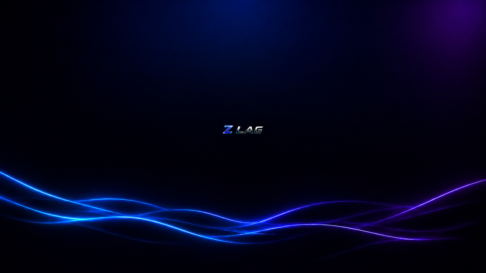

# Z LAG OS — Zero Lag Gaming Operating System

[](LICENSE)
[](https://www.microsoft.com/windows)
[](https://ameliorated.io/)
[](https://github.com/MrPcGamerYT/Z-LAG-OS/releases)
[]()

> **Maximum FPS. Zero Lag. No Bloat.** A performance-first AME Wizard playbook engineered for competitive gaming, Android emulators (BlueStacks / MSI App Player / LDPlayer), and low-end hardware — universal for **Windows 10 and Windows 11**.



---

### ⚠️ CRITICAL DISCLAIMER
This playbook applies **aggressive system-wide modifications**: it disables telemetry, strips built-in apps, blocks updates, removes the OneDrive client (local sync folders preserved), Edge/WebView2, Cortana/Widgets, purges services, and modifies kernel power & scheduler policies. It is designed for **performance-critical gaming environments only**. Create a restore point and use a **Local Offline Account**.

---

## 📚 Table of Contents
- [Why Z LAG OS](#-why-z-lag-os)
- [Feature Highlights](#-feature-highlights)
- [Installation](#-installation)
- [Setup Options](#-setup-options)
- [Z LAG TOOLBOX Context Menu](#-z-lag-toolbox-context-menu)
- [Clean & Compact Start Menu](#-clean--compact-start-menu)
- [Maximum FPS Power Plan](#-maximum-fps-power-plan)
- [Expected Performance Gains](#-expected-performance-gains)
- [What Is Removed vs Preserved](#-what-is-removed-vs-preserved)
- [Compatibility](#-compatibility)
- [Changelog](#-changelog)
- [FAQ](#-faq)
- [Validation](#-validation)
- [Contributing](#-contributing)
- [License & Credits](#-license--credits)

---

## 🎯 Why Z LAG OS

Most "gaming optimizers" flip a few registry switches and call it a day. Z LAG OS is a complete, engineered pipeline of **38 sequential tasks** that rebuilds Windows around one goal: **every CPU cycle, every millisecond of latency, and every megabyte of RAM goes to your game.**

| Goal | How it is achieved |
| :--- | :--- |
| **Latency Minimization** | Reversible foreground/MMCSS and memory profile, hardware-aware GPU scheduling, Windows-managed boot timing, MSI mode on the GPU |
| **Stable FPS (no mid-game drops)** | Zero scheduled activity during gameplay, thermal-headroom power tuning (no heat-soak throttling), core parking off, Multi-Plane Overlay disabled (no flicker/stutter), memory compression kept ON (no pagefile hitches) |
| **Raw Input** | Correct 40-byte linear mouse curves (true 1:1, zero acceleration), native driver input queue capacity preserved, USB selective suspend and USB3/PCIe link power management forced OFF so input devices can never sleep mid-game |
| **Heavy Debloat** | 60 + built-in apps removed, 100 + services disabled or demand-only, telemetry blocked at host + task + service level, Edge/WebView2/OneDrive fully removed |
| **RAM Efficiency** | Svchost consolidation, Superfetch/Search indexing off, visual effects off, working-set trims — target idle: **~1.2–1.9 GB RAM, ~40–55 processes** |
| **Network Latency** | TCP NoDelay/ACK preferences on existing interfaces; supported NIC moderation/EEE preferences applied without restarting adapters. Driver support and latency effects vary; no destructive stack reset |
| **AppX Stability** | The complete packaged-app runtime framework set is hard-protected, to reduce UWP/sideloaded app launch failures; licensing, account, WebView2 and app-specific dependencies still apply |

---

## ✨ Feature Highlights

- 🚀 **Non-resident maintenance** — persistent maintenance is triggered at boot/logon rather than on a repeating timer. Startup rechecks and the Welcome panel can still overlap an early gaming session.
- 🖥️ **Clean compact Start Menu** — no pinned tiles, no Recommended section, no "Most used"/"Recently added" lists. Pure app list, on both Windows 10 and 11.
- 🖱️ **Z LAG TOOLBOX right-click menu** — 12 built-in tools including one-click GAME BOOST, standby-memory clear, ping/jitter test, and instant Max FPS power plan re-activation.
- ⚡ **Maximum FPS power plan** — created once, tuned by GUID, activated and **verified**; the exact plan GUID is recorded so it can always be restored in one click.
- 🎨 **Custom native experience** — Z LAG Welcome panel at logon (Task Scheduler based — invisible to Startup apps), ElegantDark cursor set, dark theme, custom wallpaper, small auto-hide taskbar, classic context menu on Windows 11.
- 🛡️ **Runtime-aware debloat** — Store/account removals are option-gated; essential AppX runtime services are preserved and repaired. This is not a guarantee that every app will work.
- 🔁 **Self-healing runtime** — a non-resident watchdog re-locks the service floor at boot/logon, and the AppX launch stack re-arms itself after every purge.
- 🧪 **Production validation** — release packaging is gated on repository regression checks and Windows PowerShell parsing. These checks do not replace Windows VM/runtime testing.

---

## 📦 Installation

1. Download the latest `Z_LAG_OS.apbx` from [Releases](https://github.com/MrPcGamerYT/Z-LAG-OS/releases).
2. Download [AME Wizard](https://ameliorated.io/) (latest beta, 0.7+).
3. **Create a restore point** (the playbook also creates one as its first real action).
4. Drag the `.apbx` into AME Wizard and follow the setup pages.
5. Pick your options (browser, Defender, Bluetooth, Wi-Fi, Store — see below).
6. Let it run (~30–60 min). The system reboots automatically when finished.

> 💡 Best results: apply on a **fresh Windows install** with a **local account**.

---

## Reversible kernel / scheduler profile

The Gaming Core runs `set_kernel_profile.ps1`: a foreground scheduling preference,
valid MMCSS responsiveness value (10), pageable executive memory and desktop cache
policy. It verifies writes, preserves a first-run snapshot outside runtime cleanup,
and attempts rollback on failure. It adds no background process and does not
replace or patch the Windows kernel. Boot clocks and security-mitigation policy
are no longer forcibly changed by this playbook.

After applying, use an elevated Windows PowerShell to restore profile-owned values:

```powershell
& "$env:SystemRoot\Z-LAG-OS\set_kernel_profile.ps1" -Restore
```

Reboot and compare frame-time percentiles under the same workload. See
`docs/kernel-profile.md` for scope, rollback and legacy-install limitations.

## Known compatibility limits

- The timer script is diagnostic only. Boot timers remain Windows-managed; no
  permanent global timer resolution or universal FPS improvement is claimed.
- `repair_appx_runtime.ps1` is retained and runs after the debloat passes. It
  restores services/policy, not removed app files, missing frameworks or licenses.
- NIC tweaks use advertised registry properties without restarting adapters;
  some need a reboot. TCP settings do not optimize UDP or guarantee lower ping.
- Edge/WebView2 removal remains aggressive. Apps using WebView2 for UI/login may
  crash or hang until the runtime is reinstalled. AppX repair cannot fix this.
- Store removal can break apps requiring Store licensing, Xbox services or
  Microsoft-account sign-in. Demand-start account services may still run on demand.
- A restore point does not back up personal files or guarantee reversal of package
  removal. Back up data and test on a disposable Windows VM first.
- Local OneDrive documents, event logs and the Recycle Bin are preserved by the
  default cleanup. Known-folder redirection may reset to local Desktop/Documents;
  preserved files can remain in the old OneDrive folder and need moving manually.

## ⚙️ Setup Options

You stay in control of how aggressive the optimization is:

| Page | Default | Max Performance Option | Effect |
| :--- | :--- | :--- | :--- |
| **Browser** | Chrome | Brave / OperaGX / None | Pre-installed browser choice |
| **Defender** | Keep (Recommended) | Disable | Frees ~150–300 MB RAM, removes scanning stutter. Advanced users only |
| **Bluetooth** | Keep | Disable | Removes the Bluetooth stack. Only for wired-peripheral setups |
| **Wi-Fi** | Keep | Disable | Stops WLAN services. Ethernet desktops only |
| **MS Store & Services** | Keep (Recommended) | Remove | Removes listed Store/consumer packages and disables targeted services. Required AppX runtime is kept; account/licensing-dependent apps may not work. Memory savings vary |

**Z-LAG Toolbox** is always installed from [GitHub Releases](https://github.com/MrPcGamerYT/Z-LAG-TOOLBOX/releases) as the official app/driver/tweak hub. App compatibility depends on each installer and its runtime requirements. Keeping AppX services does not restore missing WebView2, application frameworks, gaming services or Store licenses.

---

## 🧰 Z LAG TOOLBOX Context Menu

Right-click the desktop or any folder background → **Z LAG TOOLBOX** (always first position). Every tool runs only when clicked and exits immediately — **zero background processes**.

| Tool | What it does |
| :--- | :--- |
| **GAME BOOST (One-Click)** | Kills respawned bloat processes (Edge, Widgets, Teams, OneDrive, GameBar…), trims all working sets, flushes DNS — click, then launch your game |
| **RAM Trim / Clean** | Releases working-set RAM from all user-session processes |
| **Clear Standby Memory** | Purges the standby page list natively — prevents mid-match allocation hitches after long sessions |
| **Temp Clean** | Cleans user + Windows temp folders, reports space reclaimed |
| **Recycle Bin Clean** | Empties the recycle bin |
| **Flush DNS Cache** | Resets the DNS resolver for a clean connection |
| **Ping / Latency Test** | Pings router + Cloudflare + Google; shows avg / max / **jitter** per hop |
| **Activate Max FPS Power Plan** | One-click re-activation of the tuned plan (verified before reporting success) |
| **System Info (Gamer View)** | OS build, free/total RAM, CPU cores/threads, GPU + driver, active power plan, live process count |
| **Restart Explorer** | Fixes shell glitches instantly |
| **Sound Manager (Classic)** | Opens the classic mmsys.cpl sound panel |
| **Volume Mixer (Classic)** | Opens the classic per-app volume mixer |

---

## 🧹 Clean & Compact Start Menu

A completely clean, compact Start Menu on **both** Windows versions — no pinned item section at all:

**Windows 10**
- Empty tile layout applied via `Import-StartLayout` + per-user layout XML
- The real pinned-tile grid (`start.tilegrid` CloudStore keys) is purged for **every user**, so pins never come back
- Full-screen/tablet Start forced off — small, compact desktop Start
- Legacy tile database cleaned on old builds

**Windows 11**
- Empty `{"pinnedList":[]}` layout per user **and** machine-wide (`ConfigureStartPins`) — new accounts start pin-free too
- `start*.bin` pin caches (including `start2.bin` on 22H2+) deleted for every profile
- Compact "More pins" layout + Recommended section hidden
- Compact File Explorer mode (dense rows, like Windows 10)

**Both**
- "Most used", "Recently added", ads/stubs and website recommendations removed at HKLM policy level (survives resets, applies to all users)
- The Start Menu host is stopped **before** cache deletion (so it can't rewrite pins from memory) and its package cache is cleared — the clean menu appears immediately

---

## ⚡ Maximum FPS Power Plan

The playbook builds a dedicated **"Maximum FPS"** plan and guarantees it is really active:

1. Created **once** from Ultimate Performance (High Performance fallback) — never duplicated on re-runs; stale copies are auto-removed
2. Tuned **by explicit GUID** on AC + DC: min CPU 5% / max 100% / aggressive boost (full speed under load, thermal headroom at idle — no heat-soak throttling), core parking off, disk/display/sleep timeouts off
3. **USB selective suspend OFF, USB3 link power OFF, PCIe ASPM OFF** — mouse, keyboard, and GPU link never power-gate mid-game
4. Activated **after** tuning and **verified** via `powercfg /getactivescheme` (with retry) — the log prints `VERIFIED: Maximum FPS plan is ACTIVE`
5. The plan GUID is recorded in the registry so the right-click tool and later playbook stages always re-activate the **exact tuned plan**, never a stock template

---

## 📊 Expected Performance Gains

*Note: varies by hardware. Tested on i5-11400F + GTX 1660 + 16 GB.*

| Metric | Stock Windows 11 | After Z LAG OS | Delta |
| :--- | :--- | :--- | :--- |
| **Idle RAM after boot** | 3.8–4.5 GB | 1.2–1.9 GB | −60% |
| **Processes** | 180–220 | ~40–55 | −70%+ |
| **Boot time (SATA SSD)** | 22 s | 12–14 s | ~−40% |
| **DPC latency (LatencyMon)** | 300–600 µs spikes | 40–90 µs avg | −80% |
| **FPS 1% lows (Valorant 1080p Low)** | 110 FPS | 165 FPS | +50% 1%-low stability |
| **BlueStacks 5 startup** | 18 s | 9 s | 2× faster |
| **Disk idle I/O** | 5–10 MB/s telemetry | <0.5 MB/s | ~−95% |

---

## 🧹 What Is Removed vs Preserved

### Removed / Disabled
- **Apps**: People, Maps, Alarms, Camera, 3D Viewer, Sticky Notes, Mail/Calendar, Feedback Hub, Get Started, Power Automate, Clipchamp, Office Hub, Teams, Skype, Copilot, Widgets, Bing apps, Solitaire, YourPhone/CrossDevice, Xbox layers (optional), and more
- **Services**: DiagTrack, dmwappush, WerSvc, SysMain, WSearch, VSS/SwPrv, RpcLocator, SNMPTRAP, vds, WMPNetworkSvc, MSDTC, Windows Backup, MapsBroker, Xbox networking, RemoteRegistry, dozens of per-user service instances, and the full ULTRA floor (System Restore/VSS, notifications, network discovery, file sharing, hotspot/ICS, WebDAV, iSCSI, clipboard history)
- **Telemetry**: CEIP tasks, compatibility appraiser, 43 hosts-file entries, update-host blocking
- **Components**: OneDrive client (local sync folders preserved), Edge, WebView2 Runtime, Cortana, News/Feeds, Search highlights, transparency, animations
- **Optional**: Defender, Bluetooth stack, Wi-Fi stack, Store + MS identity/gaming services

### Preserved (for stability)
- **GPU drivers, panels & apps** — NVIDIA / AMD / Intel are never touched, including the new **NVIDIA App** (a WinUI3 MSIX package): it keeps its background container / in-game overlay (per-app background policy), and no removal pass — not even the Edge/WebView2 remover — can ever pattern-match a vendor package
- **Windows Defender (when kept)** — fully functional: services alive, signatures updating (the definition CDN is never blocked), scheduled scans on, security alerts visible, Windows Security app fast. Every Defender-specific tweak is locked behind the `defender-disable` option; the late-running `defender_guard.ps1` re-establishes the keep path if anything interfered
- **AppX runtime frameworks** — VCLibs, UI.Xaml, .NET Native, WindowsAppRuntime/SDK, App Installer, sign-in brokers, shell surface packages: near-zero footprint, but removing them crashes every packaged app
- **Windows shell AppX services** — AppXSvc, StateRepository, LicenseManager, ClipSVC stay alive even with "Remove MS Services" so the Start Menu, Search, and Toolbox-installed apps keep launching
- **Text-input stack** — demand-start (0 idle footprint), never hard-disabled, so keyboard input always works
- **Font cache** — kept (killing it causes shell-wide text-rendering stutter)
- **Memory compression** — kept ON (prevents pagefile hitching on 8/16 GB systems)
- **Networking core** — TCP/IP, DHCP, DNS cache, firewall; Wi-Fi/Bluetooth kept unless you opt out
- **Boot-critical services** — anything with Start ≤ 1 is never touched; the OS always boots cleanly
- **VC++ Runtimes 2015+, DirectX Jun2010, .NET Framework** — installed/kept for game compatibility

---

## 💻 Compatibility

**Broad Windows 10 + Windows 11 compatibility is the goal:** one `.apbx`,
with build-aware checks and graceful skips for optional features. This is not a
claim that every build, edition and hardware combination has been tested.

- **Windows 10:** target the release family, including LTSC/LTSB where the
  required tooling exists. Earlier releases may lack modern AppX cmdlet options,
  runtimes or installer support. HAGS is skipped before build 19041 (2004).
- **Windows 11:** 21H2 onward, with later builds handled conservatively. Legacy
  `TaskbarSi` sizing is used only before build 22621; newer taskbars keep native
  sizing. Policies can be ignored depending on edition/build.
- **Architecture:** x64 is the primary target. ARM64/x86 depend on AME Wizard,
  third-party installers, native payloads and drivers; they are not universally
  validated or guaranteed by a registry-compatible script.
- **Tooling:** Windows PowerShell 5.1, compatible AME Wizard, administrator/SYSTEM
  privileges and the required inbox modules. Stripped/custom builds can be
  missing essential components; repair cannot recreate all deleted Windows files.
- **Languages:** numeric GUIDs/registry keywords are preferred where possible;
  third-party installers and legacy command parsing still need locale testing.

Win11-only passes remain gated behind `builds: ['>=22000']`. Unknown native
layout formats are left untouched instead of forcing another build's binary
settings. Pure build-matrix tests are useful guards, **not** substitutes for
Windows 10/11 VM and real-hardware testing. See `docs/windows-compatibility.md`.

---

## 📜 Changelog

<details>
<summary><b>v5.20 — NVIDIA App fixed + Defender option isolation (keep path fully functional)</b></summary>

**NVIDIA App "not working" — root causes fixed:**
- The new NVIDIA App is a WinUI3 MSIX package. The global UWP background ban (`LetAppsRunInBackground=2` policy + `GlobalUserDisabled=1`) killed its background container, breaking the in-game overlay. Background access is now banned **per-app** (`protect_gpu_apps.ps1`): every non-GPU package stays background-banned (same footprint), while NVIDIA / AMD / Intel packages and the Windows Security app keep access — for every user profile
- `remove_edge.ps1` no longer removes AppX packages with a broad `Edge|WebView` regex: removal is an explicit Microsoft Edge/WebView2 allowlist plus a hard vendor guard (NVIDIA / AMD / Intel and MSIX runtime frameworks can never be matched), also applied to provisioned packages and per-profile `AppData\Local\Packages` folders
- `win11_process_floor.ps1` and `RemoveStoreServices.ps1` package-removal loops gained the same hard GPU-vendor guard (defense in depth against future list edits)
- `appx_remover.ps1` keep list now names the NVIDIA App explicitly (`NVIDIAApp`, GeForce Experience, overlay, NvContainer) on top of the vendor-wide match

**Defender "keep" path — no more interference (Win10 + Win11):**
- `defender_guard.ps1` (runs late in task 34) is the keep-side enforcement point: it re-enables + starts `WinDefend`, `WdNisSvc`, `SecurityHealthService`, `wscsvc`, removes stale disable policies, re-enables Defender scheduled scans, restores security-alert notifications and forces a signature update — and exits immediately if `defender-disable` was selected
- `07_defenderAggressive.yml` now OWNS every Defender-specific action (disable policies, services, scheduled scans, security-center alert suppression) and sets the `DefenderRemoved` marker; it is the only place that touches Defender
- `wscsvc` (Windows Security Center) is no longer force-disabled by the process floor when Defender is kept — this was why the Windows Security app loaded slowly / looked broken; with Defender removed it is disabled via the option task instead
- `download.microsoft.com` is **never blocked anymore** (it serves Defender signature/engine definitions — blocking it is what made kept protections "take a while loading"); legacy blocks from older versions are auto-cleaned from the hosts file by both `add_update_hosts.ps1` and `defender_guard.ps1`
- `13_blockUpdates.yml` only clears `SoftwareDistribution\Downloads` + `DataStore` instead of destroying the whole tree
- Defender Security Center notification suppression moved out of the unconditional notifications task into the option-gated removal task; `final_push.ps1`, `process_floor.ps1` and toolbox GAME BOOST all gate their Windows-Security actions on the `DefenderRemoved` marker

**Gaming/network compatibility improvements:**
- Obsolete Chimney/NetDMA commands removed; TCP preferences are not represented as UDP optimizations
- Timer-resolution diagnostic in the Gaming Core; reversible kernel profile with verified values, first-run snapshot and rollback
- **GPU-aware HAGS** (`set_gpu_scheduling.ps1`): requests HAGS using `HwSchMode=2` for recognized modern GPUs; unknown/legacy adapters retain their current preference. Driver support and performance gains require testing on the target hardware.
- **Fixed-size pagefile** (`set_pagefile.ps1`): clamp(RAM, 4–16 GB) on the actual system drive, with free-space/user-fixed guards, verification and rollback on failure. A fixed cap can exhaust commit under heavy workloads; use Windows system-managed sizing when needed. It does not guarantee fewer frame-time spikes or sufficient crash-dump space.
- **GameXc (Gaming Services)** added to the Win11 service floor — last auto-start Xbox-stack service now removed from the idle footprint (Xbox Live sign-in for PC titles still works via the on-demand XblAuthManager/XboxGipSvc services)

**Version metadata synced** (README badge/footer now match the playbook).
</details>

<details>
<summary><b>v5.19 — Clean compact Start Menu, universal Win10/11</b></summary>

- Windows 10 pinned section fully removed: the real pin grid (`start.tilegrid` CloudStore keys) is now purged for every user — pins can no longer come back
- Machine-wide HKLM policies: no "Most used", no "Recently added", no ads/stubs, no website recommendations — applies to all users and survives resets
- Windows 11: device-wide empty pin list, compact "More pins" Start layout, compact File Explorer
- Windows 10: full-screen/tablet Start forced off, collapsed tray
- Start Menu host stopped before cache deletion + package cache cleared, so the clean menu appears immediately
</details>

<details>
<summary><b>v5.18 — Maximum FPS plan verified-active + universal Start Menu engine</b></summary>

- Power plan flow rewritten: reuse-or-create once, tune by explicit GUID (AC+DC), activate AFTER tuning, verify via `/getactivescheme` with retry, record GUID for the context-menu tool
- Removed the legacy duplicate-and-activate pass that created duplicate plans and could re-activate an untuned stock template
- Start Menu engine split per OS: `Import-StartLayout` (Win10) vs `pinnedList` JSON (Win11), with `start*.bin` purge and host-stop on both
</details>

<details>
<summary><b>v5.17 — Start Menu cleaner fixed + production hardening</b></summary>

- Fixed three root causes of the broken cleaner: an orphaned layout script that never ran, `start2.bin` (Win11 22H2+) never being deleted, and the host rewriting caches from memory
- Regression test suite extended to cover every historical bug class; all 37 scripts declare an explicit error policy; CI validation staged in `docs/ci/`
</details>

<details>
<summary><b>v5.16 — Universal Win10/11 + expanded TOOLBOX (12 tools)</b></summary>

- Added GAME BOOST, Clear Standby Memory, Ping/Latency Test, Activate Max FPS Power Plan, System Info (Gamer View)
- All tools use APIs available on both PowerShell 5.1 (Win10) and Windows 11
</details>

<details>
<summary><b>v5.15 — AppX crash-proofing, anti-flicker, raw input</b></summary>

- Full AppX runtime framework set hard-protected (no more packaged-app crashes)
- Store no longer removed by the base pass (option-gated with licensing handled)
- Multi-Plane Overlay disabled (the documented NVIDIA/AMD flicker/stutter fix)
- Windows-managed boot timers; no undocumented global timer override or unsupported SFIO priority claim; machine-wide GameDVR policy
- Driver-level mouse/keyboard queue tuning for faster input delivery
</details>

<details>
<summary><b>v5.14 — Mid-game FPS drops + input issues fixed</b></summary>

- Watchdog tasks no longer repeat during gameplay (boot/logon only) — zero scheduled activity while playing
- Correct 40-byte linear mouse curves (previous builds wrote corrupt values)
- USB selective suspend / USB3 LPM / PCIe ASPM forced off; input devices never power-gate
- Thermal-headroom power tuning (min CPU 5%, boost aggressive) — no more heat-soak throttling
- GPU MSI message limit removed; memory compression kept ON; destructive network resets removed; font cache preserved; Game Mode enabled
</details>

<details>
<summary><b>v5.13 and earlier</b></summary>

- First-run core reset, visible runtime storage under `C:\Windows\Z-LAG-OS`, Task Scheduler based Welcome panel, self-healing AppX runtime, ULTRA process/RAM floor, Edge/WebView2/OneDrive removal engines, telemetry host blocking, and the full 38-task pipeline
</details>

---

## ❓ FAQ

**Q: Is this a custom Windows ISO?**
A: No. It's a playbook (`.apbx`) that transforms a clean official Windows install via AME Wizard. Nothing is redistributed or pirated.

**Q: How many background processes after install?**
A: Target is **~40–55** at idle (depends on GPU driver and whether Defender/Store are kept). Check anytime: right-click desktop → Z LAG TOOLBOX → System Info (Gamer View).

**Q: Will my UWP / packaged apps crash after the debloat?**
A: No. The complete AppX runtime framework set (VCLibs, UI.Xaml, WindowsAppRuntime, sign-in brokers, shell surfaces) is hard-protected, and shell AppX services stay alive even with "Remove MS Services" selected.

**Q: How do I know the Maximum FPS power plan is really active?**
A: Settings → Power shows "**Maximum FPS**" selected, and the install log prints `VERIFIED: Maximum FPS plan is ACTIVE`. If any driver installer switches plans later: right-click desktop → Z LAG TOOLBOX → **Activate Max FPS Power Plan**.

**Q: The Start Menu still shows some pins right after install?**
A: The menu is rebuilt immediately at apply time and finalized on the automatic reboot. After reboot: pure app list, no pinned section, no Recommended.

**Q: I removed the Store and an app says "The service has not been started"?**
A: The shell's own AppX runtime (LicenseManager, ClipSVC, AppXSvc, StateRepository) is kept and self-heals at boot/logon. If it ever happens, run `repair_appx_runtime.ps1` as Admin and reboot.

**Q: An app says WebView2 is missing?**
A: Expected — WebView2 is intentionally removed. Reinstall Microsoft's Evergreen WebView2 Runtime if a specific app needs it.

**Q: Bluetooth Keep is selected but pairing fails?**
A: Pairing dependencies (CDPSvc, CDPUserSvc, NcbService, Device Association) are globally protected in Keep mode. If the adapter itself shows Code 10/43, that's an OEM driver/BIOS issue.

**Q: Why did the process count rise again after first boot?**
A: Windows re-creates per-user service instances at logon. The non-resident `ZLAG-EnforceServiceFloor` task re-locks the floor at boot/logon (never during gameplay), so the count settles back down.

**Q: Will Windows Update break this?**
A: Updates are blocked (hosts + services). To update later, restore the hosts file and re-enable the update services first.

**Q: Is disabling Defender safe?**
A: Only for advanced users (tournament PCs behind a hardware firewall). Keep it enabled for daily-driver machines.

**Q: FPS not improved?**
A: Verify the Maximum FPS plan is active, your GPU driver is a clean install, and no OEM utility re-enabled power saving. Then use GAME BOOST before launching.

---

## ✅ Validation

Run the full repository validation suite before packaging:

```bash
python3 tests/validate_repo.py
```

It verifies: playbook/version metadata, JSON/XML/YAML data files, the exact 01–38 task order, all task-to-executable references, runtime layout contracts, the Welcome task XML, PowerShell brace/paren balance for all 37 scripts, explicit error-policy in every script, and **regression guards** for every historical bug class (power-plan activation, Start Menu contract, AppX keep-list, watchdog scheduling, input curves, network safety, context-menu wiring).

CI workflow files (PowerShell AST parse + PSScriptAnalyzer gate on every push) are staged in [`docs/ci/`](docs/ci/README.md).

---

## 🛠️ Contributing

1. Fork the repository
2. Create a branch: `git checkout -b feature/MyTweak`
3. Commit: `git commit -m 'Add registry tweak: XYZ'`
4. Run `python3 tests/validate_repo.py` — it must pass
5. Open a Pull Request with registry paths + before/after benchmarks

Please test on a VM (VMware Workstation with nested virtualization) before opening a PR.

---

## 📝 License & Credits

**Proprietary — Use Only. No Modification or Reuse.** See [LICENSE](LICENSE).

- ✅ You may use the unmodified Software for its intended purpose.
- ❌ You may not modify, adapt, or create derivative works.
- ❌ You may not reuse its code, scripts, configurations, or assets in another project.
- ❌ You may not redistribute, sell, sublicense, or republish the Software.

Written permission from the copyright owner (**MR.PC GAMER / Z-LAG Community**) is required for anything outside this limited use permission. All rights reserved.

### Credits
- **AME Wizard Team** — framework
- **[Z-LAG Toolbox](https://github.com/MrPcGamerYT/Z-LAG-TOOLBOX)** — official app/driver/tweak hub
- **AtlasOS & RevisionOS** — inspiration for advanced registry tweaks, adapted and extended
- **MR.PC GAMER (MrPcGamerYT)** — maintainer, Z LAG Community
- **ElegantDark cursor set** — open-source cursor designers

**⭐ Star this repo if you got an FPS boost!**

---
*Z LAG OS v5.18 — Zero Lag, Max Performance. Built for gamers, by gamers.*
